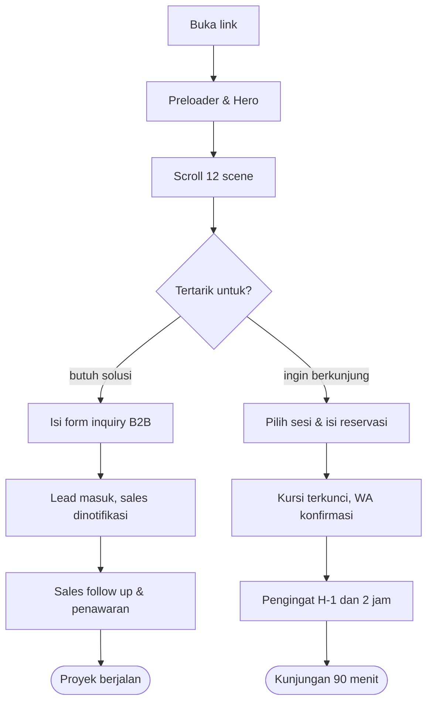
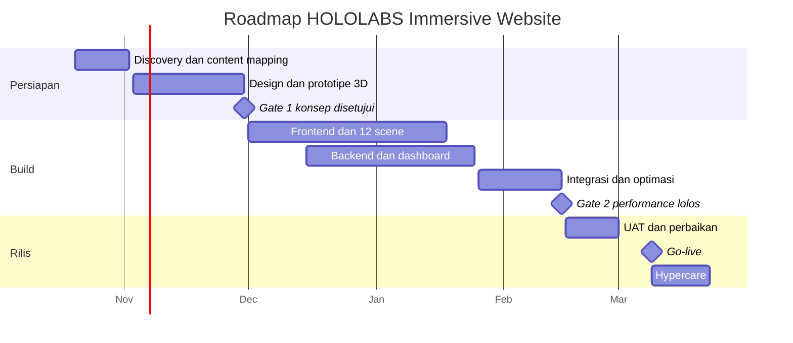

# PRD Master — HOLOLABS Immersive Parallax Website

Oct 7, 2026 · @Dev Spero · Sumber: `company profile_HOLOLABS.pdf` (28 halaman)

Versi hidup yang bisa dikomentari: https://claude.ai/code/artifact/8a5ae150-bc4f-425d-9e69-c73517c5aaf0

## 1. Project Overview / Product Vision

**Nama project:** HOLOLABS Immersive Website — codename `hololabs-web`.

Website company profile HOLOLABS yang dibangun sebagai satu perjalanan scroll: isi compro 28 halaman diterjemahkan menjadi 12 scene 3D ber-parallax, bukan halaman statis yang di-scroll biasa. Logo "H" dirender sebagai objek kaca 3D yang berputar dan berubah material mengikuti posisi scroll, sementara layer visual (background nebula, mid-ground panel, foreground siluet pengunjung) bergerak pada kecepatan berbeda sehingga ruang terasa punya kedalaman.

Setiap scene memakai gerak yang mewakili layanannya: scene Projection memakai light sweep ke permukaan bangunan, scene Game & Simulation memakai partikel yang bereaksi ke kursor, scene 3D Printing membangun mesh lapis demi lapis saat di-scroll. Website ini sekaligus pintu masuk reservasi Experience Journey 90 menit dan jalur inquiry untuk klien B2B.

**Latar belakang.** HOLOLABS menjual pengalaman imersif — projection mapping, interactive display, VR, AI avatar, DJ/VJ audio reactive, 3D printing. Compro berbentuk PDF tidak bisa membuktikan klaim itu: calon klien hanya melihat gambar diam dan harus membayangkan sendiri hasilnya. Website ini menjadi bukti pertama bahwa tagline *Where technology becomes experience* bukan sekadar kalimat; pengunjung merasakan versi kecilnya sejak detik pertama scroll.

**Target user utama:**

- Brand, agency, dan event organizer yang mencari vendor experience untuk aktivasi, pameran, atau launching.
- Corporate, developer properti, dan retail yang butuh solusi display, smart space, atau system integration.
- Sekolah, kampus, dan komunitas yang mencari kunjungan edukatif.
- Publik umum yang ingin memesan tiket Experience Journey 90 menit.
- Tim internal HOLOLABS yang memakai website sebagai alat jualan saat pitching.

## 2. Problem Statement & Goals

### Problem Statement

Compro HOLOLABS hanya hidup sebagai PDF 65 MB berisi 28 halaman gambar. Formatnya menimbulkan empat masalah:

1. **Produk tidak terbukti.** HOLOLABS menjual pengalaman yang bergerak, merespons, dan mengelilingi orang. PDF menyampaikannya lewat gambar diam, jadi calon klien harus membayangkan sendiri hasil akhirnya.
2. **Distribusi berat dan buntu.** File 65 MB gagal dikirim lewat email dan berat dibuka di HP. Tidak ada link yang bisa disebar di WhatsApp, Instagram bio, atau tanda tangan email.
3. **Tidak ada jalur konversi.** Pembaca yang tertarik di halaman 16 ("Book Your Seat") tidak punya tombol untuk benar-benar memesan. Minat berhenti di situ.
4. **Nol data.** Tidak ada cara tahu siapa yang membuka, bagian mana yang menarik, dan layanan apa yang paling dicari.

**Dampak kalau dibiarkan.** HOLOLABS tetap dinilai setara vendor display biasa karena tidak ada bukti kemampuan yang bisa dirasakan. Setiap pitching menuntut presentasi tatap muka, sehingga jumlah prospek dibatasi kapasitas tim, bukan kapasitas pasar. Experience Journey berisiko dibuka dengan kursi kosong karena tidak ada kanal reservasi yang bisa diakses publik.

### Goals

1. Mengubah compro 28 halaman menjadi satu website scroll-driven yang membuktikan kemampuan HOLOLABS dalam 3 menit pertama kunjungan.
2. Membuka kanal reservasi Experience Journey yang bisa diakses 24 jam tanpa perlu menghubungi tim.
3. Menyediakan satu link yang layak dikirim ke klien korporat, menggantikan lampiran PDF.
4. Mengumpulkan data perilaku pengunjung sebagai dasar prioritas layanan dan materi penjualan.
5. Menjaga pengalaman kelas atas tetap terbuka di perangkat kelas menengah, bukan hanya di laptop kencang.

### Success Metric

| Metric | Target 3 bulan pasca-launch | Cara ukur |
| --- | --- | --- |
| Scroll depth median | ≥ 60% dari total tinggi halaman | Event tracking per scene |
| Durasi sesi rata-rata | ≥ 2 menit 30 detik | Analytics |
| Lead inquiry B2B masuk | ≥ 25 per bulan | Tabel `leads` di database |
| Reservasi Experience Journey | ≥ 150 kursi per bulan | Tabel `bookings` |
| Frame rate scene 3D di mid-range Android | ≥ 30 FPS pada persentil 75 | Real user monitoring |
| Largest Contentful Paint (mobile 4G) | ≤ 2,5 detik | Lighthouse CI + field data |
| Bounce di bawah scene 2 | ≤ 35% | Analytics |

Project dinyatakan berhasil bila website menjadi materi utama yang dikirim tim sales menggantikan PDF, dan reservasi Experience Journey masuk tanpa perlu dijemput lewat chat manual.

## 3. User Personas / Roles

Website punya dua lapis pengguna: pengunjung publik yang tidak login, dan tim internal yang mengelola isi lewat dashboard.

### Visitor (publik, tanpa login)

Siapa: calon klien, pelajar, keluarga, atau siapa pun yang menerima link dari sales, Instagram, atau pencarian Google. Mayoritas membuka dari HP Android kelas menengah dengan koneksi 4G.

Akses: seluruh halaman publik, form inquiry, dan alur reservasi Experience Journey. Tidak punya akun, tidak melihat data siapa pun.

Tujuan: memahami apa itu HOLOLABS dalam waktu singkat, menilai apakah layak dipakai, dan — untuk sebagian — memesan kursi.

### Brand / Corporate Client (lead, tanpa login)

Siapa: marketing manager brand, event organizer, procurement korporat, atau kepala sekolah. Membuka website untuk menilai vendor, sering sambil membandingkan dengan dua sampai tiga vendor lain.

Akses: sama seperti Visitor, ditambah unduh company profile PDF dan form inquiry dengan pilihan layanan serta estimasi budget.

Tujuan: memastikan HOLOLABS pernah mengerjakan skala yang mereka butuhkan, lalu menghubungi tim dengan brief awal yang sudah terisi.

### Content Admin (login)

Siapa: staf marketing HOLOLABS. Bukan developer, tidak boleh menyentuh kode.

Akses: membuat dan mengubah isi scene, portfolio, jadwal sesi Experience Journey, serta membaca lead yang masuk. Tidak bisa mengubah pengaturan 3D, menghapus data permanen, atau mengelola akun pengguna.

Tujuan: mengganti teks, foto, dan jadwal tanpa menunggu antrean developer.

### Super Admin (login)

Siapa: pemilik produk atau technical lead HOLOLABS.

Akses: seluruh kemampuan Content Admin, ditambah mengelola akun, mengubah parameter scene 3D (intensitas parallax, kualitas render, aset model), menghapus data, melihat audit trail, dan mengekspor lead serta booking.

Tujuan: menjaga performa dan integritas data, serta mengatur siapa boleh mengerjakan apa.

### Ringkasan hak akses

| Kemampuan | Visitor | Lead | Content Admin | Super Admin |
| --- | --- | --- | --- | --- |
| Lihat halaman publik | Ya | Ya | Ya | Ya |
| Kirim inquiry | Ya | Ya | Ya | Ya |
| Reservasi kursi | Ya | Ya | Ya | Ya |
| Unduh compro PDF | Ya | Ya | Ya | Ya |
| Edit konten scene & portfolio | Tidak | Tidak | Ya | Ya |
| Kelola jadwal sesi | Tidak | Tidak | Ya | Ya |
| Baca & balas lead | Tidak | Tidak | Ya | Ya |
| Ubah parameter 3D & kualitas render | Tidak | Tidak | Tidak | Ya |
| Kelola akun pengguna | Tidak | Tidak | Tidak | Ya |
| Hapus permanen & lihat audit trail | Tidak | Tidak | Tidak | Ya |
| Ekspor data lead & booking | Tidak | Tidak | Tidak | Ya |

## 4. Scope & Deliverables (MVP Scope)

### In Scope

**Halaman publik — 12 scene parallax**

1. Scene 00 — Preloader: logo "H" 3D merakit diri sambil aset dimuat, dengan progress 0–100%.
2. Scene 01 — Hero: logo H kaca 3D di tengah koridor imersif, tagline *Where technology becomes experience*, tiga pilar Immersive · Interactive · Intelligent.
3. Scene 02 — Brand Essence: filosofi simbol H sebagai jembatan physical world dan digital world; dua sisi logo saling menjauh lalu menyatu mengikuti scroll.
4. Scene 03 — Integration: tiga bidang kaca transparan, overlapping, dan layered yang tersusun menjadi satu ekosistem Technology + Content + Space + Interaction = Experience.
5. Scene 04 — Color Journey: gradasi cyan → violet → magenta sebagai perjalanan Technology → Creativity → Experience.
6. Scene 05 — Our DNA: lima karakter brand (Futuristic, Experimental, Immersive, Interactive, Intelligent) sebagai kartu yang masuk berurutan.
7. Scene 06 — One Lab, Multiple Possibilities: delapan area layanan dalam grid 3D yang bisa dibuka satu per satu.
8. Scene 07–09 — Deep dive layanan: Projection, Display, Game & Simulation, AI Solutions, VR, 3D Printing, Smart Space, DJ/VJ.
9. Scene 10 — The Ecosystem: empat layer (Immersive, Interactive, Intelligent, Physical) menumpuk menjadi satu bangunan isometrik saat di-scroll.
10. Scene 11 — Experience Journey: alur 90 menit dalam enam tahap, dengan ajakan reservasi.
11. Scene 12 — How We Work & Why HOLOLABS: enam tahap kerja Discover → Experience, lalu manifesto penutup.
12. Footer: kontak, peta lokasi, media sosial, unduh compro PDF.

**Fitur fungsional**

- Sistem parallax scroll-driven dengan smooth scrolling dan scene yang dipicu posisi scroll.
- Mesin 3D: logo H, bidang kaca, partikel reaktif, dan satu model isometrik ekosistem.
- Mode degradasi otomatis: versi penuh (3D + parallax), versi ringan (parallax 2D + video), versi statis (gambar + teks) sesuai kemampuan perangkat.
- Galeri portfolio dengan filter per layanan.
- Form inquiry B2B dengan pilihan layanan, skala acara, dan rentang budget.
- Alur reservasi Experience Journey: pilih tanggal → pilih sesi → isi data → konfirmasi.
- Website builder di dashboard admin: seluruh teks, gambar, video, urutan, dan visibilitas scene bisa diubah tanpa developer, dengan alur draft, preview, publish, dan rollback. Termasuk kelola portfolio, jadwal sesi, lead, dan booking. Rinciannya di Lampiran B.
- Dua bahasa: Indonesia dan Inggris.
- SEO teknis: meta per scene, Open Graph, sitemap, structured data organisasi.
- Analytics perilaku: scroll depth per scene, waktu tinggal, dan interaksi 3D.

### Out of Scope

- Pembayaran online untuk tiket Experience Journey. MVP hanya sampai reservasi kursi; pembayaran dilakukan di lokasi.
- Aplikasi mobile native, baik Flutter maupun Capacitor.
- WebXR atau mode VR di dalam browser.
- Blog, newsletter, dan content marketing engine.
- Akun pelanggan dengan riwayat kunjungan dan poin loyalitas.
- Live chat dengan agen manusia.
- Produksi video, foto, dan 3D asset dari nol. PRD ini mengasumsikan aset visual berasal dari compro yang sudah ada dan materi yang disediakan HOLOLABS.
- Integrasi ERP, invoicing, dan akuntansi.
- Dashboard analytics kustom di dalam aplikasi. MVP memakai Google Analytics 4.

### Deliverables

| Deliverable | Bentuk |
| --- | --- |
| Source code website | Repository Git privat, branch `main` siap deploy |
| Website live | Domain produksi + environment staging |
| Dashboard admin | Bagian dari aplikasi yang sama, jalur `/admin` |
| Paket aset 3D | File `.glb` terkompresi Draco + tekstur `.ktx2` |
| Design system | Token warna, tipografi, spacing, motion dalam file desain dan kode |
| Dokumentasi teknis | README, panduan environment, cara deploy, struktur scene |
| Panduan admin | Dokumen cara mengelola konten dan jadwal, bahasa Indonesia |
| Laporan UAT | Checklist terisi beserta hasil uji lintas perangkat |
| Serah terima akses | Domain, hosting, database, analytics, dan repository |

## 5. Platform & Design

### Platform

Web only, responsif, dengan dashboard admin di dalam aplikasi yang sama. Tidak ada aplikasi mobile.

Dukungan browser: Chrome, Edge, Safari, dan Firefox dua versi terakhir. Safari iOS 15 ke atas. Perangkat tanpa WebGL2 tetap dilayani lewat mode statis.

### Mobile Approach

Tidak memakai Flutter maupun Capacitor. Mobile ditangani sebagai web responsif dengan tiga tingkat kualitas:

| Tingkat | Syarat perangkat | Yang dirender |
| --- | --- | --- |
| Full | WebGL2, memori ≥ 4 GB, bukan mode hemat data | Scene 3D penuh, partikel, post-processing bloom |
| Lite | WebGL2 tapi GPU lemah, atau layar < 768 px | Parallax 2D berlapis, logo H sebagai video alpha, tanpa partikel |
| Static | Tanpa WebGL2, `prefers-reduced-motion`, atau koneksi 2G/3G | Gambar still + teks, tanpa animasi scroll |

Deteksi dilakukan sekali saat halaman dimuat dan dapat diturunkan otomatis bila frame rate jatuh di bawah 24 FPS selama 3 detik.

### Design Theme / Style

**Mood.** Futuristik, gelap, sinematik. Halaman publik memakai latar near-black agar cahaya neon logo dan scene terasa menyala, persis seperti halaman-halaman gelap di compro. Bagian manifesto dan penutup berpindah ke latar putih bersih, meniru pergantian terang-gelap yang sudah dipakai compro.

**Warna.** Diambil langsung dari filosofi warna di compro: perjalanan Technology → Creativity → Experience.

| Token | Nilai | Makna di compro | Dipakai untuk |
| --- | --- | --- | --- |
| `--holo-cyan` | `#22D3FF` | Technology, Digital, Innovation | Aksen utama, garis, highlight |
| `--holo-blue` | `#2B6BFF` | Precision, Engineering | Gradien kiri logo, link |
| `--holo-violet` | `#8B5CF6` | Creativity, Imagination, Immersion | Titik tengah gradien |
| `--holo-magenta` | `#F02FC2` | Energy, Emotion, Human Experience | Call to action, aksen akhir |
| `--holo-ink` | `#05060A` | — | Latar scene gelap |
| `--holo-paper` | `#F7F8FC` | — | Latar scene terang |

Gradien tanda tangan: `linear-gradient(90deg, #22D3FF 0%, #8B5CF6 52%, #F02FC2 100%)`. Dipakai pada judul, garis pemisah, dan rim light objek 3D.

**Tipografi.** Judul memakai sans-serif geometris tebal dengan karakter lebar, mengikuti headline compro: Space Grotesk atau Archivo, berat 700–800, tracking rapat. Isi teks memakai Inter berat 400–500 dengan tinggi baris 1,6. Label kategori memakai huruf kapital, berat 500, tracking 0,18em, meniru label `01 — WHO WE ARE` di compro.

**Sistem parallax.** Setiap scene punya tiga lapis kedalaman:

- Background — nebula, grid ruang, atau gradien. Bergerak 0,2× kecepatan scroll.
- Mid-ground — objek 3D utama dan panel konten. Bergerak 0,6×.
- Foreground — siluet pengunjung, partikel, dan bingkai. Bergerak 1,1× sehingga terasa melewati kamera.

Transisi antar-scene memakai satu kamera tunggal yang bergerak menyusuri jalur spline, bukan potongan halaman terpisah. Scroll terasa seperti berjalan menembus koridor HOLOLABS.

**Motion.** Durasi 400–900 ms, easing `cubic-bezier(0.22, 1, 0.36, 1)`. Tidak ada animasi yang memblokir pembacaan teks. Seluruh animasi scroll berhenti bila `prefers-reduced-motion: reduce` aktif, diganti fade sederhana.

**Referensi.** Arah visual mengikuti situs studio experiential seperti Active Theory, Lusion, dan Bruno Simon untuk perlakuan 3D dan scroll; Apple product page untuk disiplin scroll-driven storytelling yang tetap terbaca; dan compro HOLOLABS sendiri sebagai sumber warna, tipografi, serta komposisi scene.

## 6. Menu & Features List

### Visitor

**Menu: Home (satu halaman scroll, 12 scene)**

- Navigasi melayang berisi penanda scene; mengklik penanda menggerakkan kamera ke scene itu, bukan melompat.
- Indikator progres scroll di tepi layar dengan gradien cyan → magenta.
- Interaksi 3D: logo H mengikuti pergerakan kursor dalam batas 8 derajat; partikel scene Game bereaksi ke sentuh dan kursor.
- Tombol jeda animasi dan tombol matikan efek 3D, tersimpan di penyimpanan lokal.
- Pemilih bahasa Indonesia dan Inggris.
- Tombol unduh company profile PDF.

**Menu: Solutions**

- Delapan kartu layanan sesuai compro: Projection, Display, Game & Simulation, AI Solutions, VR Solutions, 3D Printing & Custom, Smart Home & Office, DJ/VJ Audio Reactive Performance.
- Setiap kartu dibuka menjadi panel berisi sub-layanan, contoh penerapan, dan galeri.
- Filter berdasarkan kategori layanan dan jenis ruang (indoor, outdoor, retail, event, edukasi).
- Tombol *Diskusikan proyek ini* yang membawa ke form inquiry dengan layanan sudah terisi.

**Menu: Experience Journey**

- Penjelasan alur 90 menit dalam enam tahap beserta durasi tiap tahap.
- Kalender ketersediaan sesi 30 hari ke depan.
- Status kursi per sesi: tersedia, tinggal sedikit, penuh.
- Pilihan tipe kunjungan: individu, keluarga, komunitas, sekolah, korporat, grup privat.
- Form reservasi: nama, nomor WhatsApp, email, jumlah orang, tipe kunjungan, catatan.
- Halaman konfirmasi berisi kode booking dan ringkasan sesi.

**Menu: Portfolio**

- Grid proyek dengan gambar sampul dan nama klien.
- Filter berdasarkan layanan, tahun, dan jenis klien.
- Urutan berdasarkan terbaru, atau pilihan manual tim.
- Halaman detail proyek: tantangan, pendekatan, teknologi yang dipakai, galeri, dan hasil.

**Menu: About**

- Filosofi brand, simbol H, lima karakter brand, dan visi.
- Alur kerja enam tahap Discover sampai Experience.
- Profil singkat tim dan kapabilitas lab.

**Menu: Contact**

- Form inquiry: nama, perusahaan, jabatan, email, WhatsApp, layanan yang diminati, perkiraan tanggal acara, rentang budget, dan deskripsi kebutuhan.
- Alamat lab dengan peta tertanam.
- Tautan WhatsApp langsung dan email.
- Tautan Instagram, LinkedIn, YouTube, TikTok.

### Content Admin

**Menu: Dashboard**

- Ringkasan lead baru, booking hari ini, dan sesi mendatang.
- Grafik lead dan booking 30 hari terakhir.

**Menu: Scene Content**

- Daftar 12 scene; ubah judul, sub-judul, isi teks, dan gambar pendukung per scene.
- Pratinjau perubahan di lingkungan staging sebelum terbit.
- Riwayat versi per scene dengan tombol kembalikan.
- Filter berdasarkan status terbit dan tanggal ubah terakhir.

**Menu: Solutions**

- Kelola delapan layanan beserta sub-layanannya: tambah, ubah, urutkan ulang, sembunyikan.
- Unggah gambar dan video pendukung.

**Menu: Portfolio**

- Tambah, ubah, hapus sementara, dan urutkan proyek.
- Unggah galeri hingga 20 gambar per proyek.
- Filter berdasarkan layanan, tahun, status terbit; pencarian berdasarkan nama klien.

**Menu: Experience Journey**

- Kelola template sesi: jam mulai, kapasitas kursi, hari aktif.
- Buka dan tutup tanggal tertentu, termasuk hari libur.
- Daftar booking dengan filter tanggal, status, dan tipe kunjungan; pencarian berdasarkan kode booking, nama, atau nomor WhatsApp.
- Ubah status booking: menunggu, dikonfirmasi, hadir, tidak hadir, batal.
- Ekspor daftar hadir per sesi ke CSV.

**Menu: Leads**

- Daftar inquiry masuk dengan filter layanan, rentang budget, status, dan tanggal.
- Urutkan berdasarkan terbaru atau nilai budget.
- Ubah status: baru, dihubungi, penawaran dikirim, menang, kalah.
- Catatan internal per lead.

### Super Admin

Seluruh menu Content Admin, ditambah:

**Menu: 3D & Performance**

- Atur intensitas parallax per scene dalam rentang 0 sampai 1.
- Atur ambang kualitas render otomatis dan batas jumlah partikel.
- Ganti berkas model 3D dan tekstur.
- Pantau frame rate lapangan dan tingkat penurunan ke mode Lite serta Static.

**Menu: Users**

- Tambah, ubah peran, nonaktifkan, dan hapus akun.
- Paksa keluar dari seluruh sesi login.

**Menu: Settings**

- Informasi perusahaan, metadata SEO, berkas compro PDF, dan tautan media sosial.
- Pengaturan notifikasi: tujuan email dan nomor WhatsApp penerima.

**Menu: Audit Log**

- Riwayat seluruh perubahan: siapa, kapan, data apa, nilai sebelum dan sesudah.
- Filter berdasarkan pengguna, jenis aksi, modul, dan rentang tanggal.
- Ekspor ke CSV.

## 7. User Flow / Workflow

Seluruh isi website berada di satu halaman scroll. Percabangan baru terjadi di ujung perjalanan, setelah pengunjung melihat kemampuan HOLOLABS, bukan di awal lewat menu.



Pengunjung yang pergi sebelum percabangan tetap dihitung: scroll depth-nya terekam per scene, sehingga tim tahu di titik mana minat berhenti.

## 8. Functional Requirements

### Authentication

Halaman publik tidak memerlukan login. Login hanya ada di `/admin`.

- Metode: email dan kata sandi, dikelola Supabase Auth.
- Wajib dua faktor lewat aplikasi authenticator untuk peran Super Admin.
- Sesi berlaku 8 jam, diperpanjang otomatis selama ada aktivitas, dan keluar paksa setelah 30 menit menganggur.
- Lima kali gagal login mengunci akun selama 15 menit.
- Reset kata sandi lewat tautan email yang berlaku 30 menit dan hanya bisa dipakai sekali.
- Tidak ada pendaftaran mandiri. Akun dibuat Super Admin.

Pemetaan peran ke menu mengikuti tabel hak akses di bagian 3. Penegakan dilakukan di dua lapis: middleware jalur `/admin` dan Row Level Security di database. Pengecekan di sisi klien hanya untuk menyembunyikan menu, bukan sebagai pengaman.

### Validasi

**Form inquiry**

| Field | Aturan |
| --- | --- |
| Nama | Wajib, 3–80 karakter |
| Perusahaan | Opsional, maksimal 100 karakter |
| Email | Wajib, format email valid, domain punya data MX |
| WhatsApp | Wajib, format Indonesia, dinormalkan ke `+62` |
| Layanan diminati | Wajib, minimal satu dari delapan pilihan |
| Tanggal acara | Opsional, tidak boleh di masa lalu |
| Rentang budget | Wajib, pilihan dari daftar tertutup |
| Deskripsi kebutuhan | Wajib, 20–1000 karakter |

**Form reservasi Experience Journey**

| Field | Aturan |
| --- | --- |
| Nama | Wajib, 3–80 karakter |
| WhatsApp | Wajib, format Indonesia, dipakai sebagai identitas booking |
| Email | Opsional, divalidasi bila diisi |
| Jumlah orang | Wajib, 1–30, tidak boleh melebihi sisa kursi sesi |
| Tipe kunjungan | Wajib, pilihan dari daftar tertutup |
| Sesi | Wajib, harus sesi yang masih buka dan belum lewat |

Ketersediaan kursi dikunci di tingkat basis data. Dua permintaan bersamaan untuk kursi terakhir hanya meloloskan satu; yang kalah menerima pesan agar memilih sesi lain. Satu nomor WhatsApp dibatasi tiga booking aktif.

**Form admin.** Judul scene maksimal 80 karakter, sub-judul maksimal 160 karakter agar tata letak tidak pecah. Unggahan gambar maksimal 5 MB per berkas, format JPG, PNG, atau WebP, dan dikonversi otomatis ke WebP serta AVIF. Model 3D maksimal 8 MB setelah kompresi Draco.

### Notifikasi

| Pemicu | Kanal | Penerima |
| --- | --- | --- |
| Inquiry baru masuk | Email + WhatsApp | Tim sales |
| Reservasi baru | WhatsApp | Pemesan |
| Reservasi baru | Email ringkasan harian | Tim operasional |
| Pengingat H-1 sesi | WhatsApp | Pemesan |
| Pengingat 2 jam sebelum sesi | WhatsApp | Pemesan |
| Reservasi dibatalkan | WhatsApp | Pemesan dan tim operasional |
| Sesi penuh | In-app | Content Admin |
| Gagal login 5 kali | Email | Super Admin |

Tidak ada push notification karena tidak ada aplikasi native.

### Requirement teknis 3D & parallax

Bagian ini mengikat kualitas pengalaman dan diuji saat UAT.

| Requirement | Target |
| --- | --- |
| Frame rate desktop, mode Full | ≥ 55 FPS |
| Frame rate mobile mid-range, mode Lite | ≥ 30 FPS |
| Total aset 3D terunduh | ≤ 6 MB untuk scene pertama |
| Waktu sampai hero bisa di-scroll | ≤ 2,5 detik pada 4G |
| Jumlah draw call per scene | ≤ 120 |
| Jumlah partikel aktif, mode Full | ≤ 25.000 |
| Konsumsi memori GPU | ≤ 300 MB |

Aturan perilaku:

1. Aset 3D dimuat bertahap. Scene berikutnya diambil saat pengguna berada di 70% scene sekarang.
2. Scene yang keluar dari layar dihentikan render-nya untuk menghemat GPU.
3. Scroll memakai smooth scrolling yang tidak membajak gestur asli; keyboard, Page Down, dan End tetap berfungsi normal.
4. Seluruh teks dalam scene adalah teks HTML sungguhan, bukan tekstur, agar bisa dipilih, dibaca pembaca layar, dan terindeks mesin pencari.
5. Setiap scene punya penanda tersembunyi untuk pembaca layar yang menjelaskan isi visualnya.
6. Bila `prefers-reduced-motion: reduce` aktif, parallax dimatikan dan diganti fade; kamera tidak bergerak.
7. Navigasi keyboard harus bisa melompati seluruh scene tanpa terjebak di dalam kanvas 3D.
8. Halaman harus tetap bisa dibaca penuh bila JavaScript gagal dimuat, memakai konten yang dirender di server.

## 9. Business Process

### Proses yang diotomasi sistem

1. **Penangkapan lead.** Inquiry yang masuk otomatis dikategorikan berdasarkan layanan dan rentang budget, lalu diteruskan ke tim sales lewat email dan WhatsApp dalam satu menit. Tidak ada lagi pencatatan manual dari chat.
2. **Reservasi kursi.** Ketersediaan dihitung sistem dari kapasitas sesi dikurangi booking aktif. Kursi berkurang saat booking dibuat dan kembali saat dibatalkan, tanpa campur tangan admin.
3. **Pengingat kunjungan.** Pesan WhatsApp H-1 dan 2 jam sebelum sesi dikirim otomatis untuk menekan angka tidak hadir.
4. **Daftar hadir.** Sistem menyusun daftar hadir per sesi yang bisa diekspor pagi hari, menggantikan rekap manual.
5. **Penurunan kualitas render.** Sistem memilih mode Full, Lite, atau Static sendiri berdasarkan kemampuan perangkat dan frame rate nyata.

### Approval flow

**Publikasi konten.** Content Admin menyunting scene, solution, atau portfolio dalam status draf. Perubahan hanya tampil di staging. Super Admin meninjau, lalu menyetujui atau menolak disertai alasan. Konten yang disetujui terbit ke produksi; yang ditolak kembali ke draf dengan catatan. Perubahan yang hanya mengoreksi salah ketik dapat diterbitkan langsung oleh Content Admin tanpa persetujuan.

**Aset 3D.** Hanya Super Admin yang boleh mengganti model dan tekstur. Aset baru wajib lolos uji performa di staging sebelum naik ke produksi.

**Pembatalan booking oleh admin.** Content Admin mengajukan pembatalan beserta alasan; Super Admin menyetujui. Pembatalan oleh pemesan sendiri tidak perlu persetujuan selama lebih dari 6 jam sebelum sesi.

**Lead.** Tidak ada persetujuan. Lead mengalir langsung ke sales; statusnya diperbarui manual mengikuti perkembangan.

### Audit trail

Seluruh aksi berikut dicatat dengan identitas pelaku, waktu, alamat IP, dan nilai sebelum serta sesudah.

| Peristiwa | Disimpan | Alasan |
| --- | --- | --- |
| Login, logout, gagal login | 12 bulan | Keamanan akun |
| Konten dibuat, diubah, diterbitkan | 24 bulan | Menelusuri perubahan dan mengembalikan versi |
| Aset 3D diganti | 24 bulan | Menelusuri penurunan performa |
| Booking dibuat, diubah, dibatalkan | 24 bulan | Sengketa reservasi |
| Status lead berubah | 24 bulan | Penelusuran penjualan |
| Akun dibuat, peran diubah, akun dihapus | 36 bulan | Tata kelola akses |
| Data diekspor | 36 bulan | Jejak data pribadi keluar sistem |

Catatan audit bersifat hanya-tambah. Tidak ada peran yang bisa mengubah atau menghapusnya dari dalam aplikasi.

## 10. Technical Stack & Integration

### Technical Stack

**Frontend**

| Lapisan | Pilihan | Alasan |
| --- | --- | --- |
| Framework | Next.js 15, App Router, TypeScript | Server rendering menjaga SEO dan fallback tanpa JavaScript |
| Rendering 3D | React Three Fiber di atas Three.js | Scene 3D dikelola sebagai komponen React, bukan kode imperatif terpisah |
| Helper 3D | Drei | Loader GLTF, kontrol kamera, dan material siap pakai |
| Scroll & timeline | GSAP ScrollTrigger + Lenis | ScrollTrigger mengikat progres scroll ke timeline scene; Lenis memberi smooth scrolling |
| Animasi UI | Framer Motion | Transisi elemen DOM di luar kanvas |
| Styling | Tailwind CSS + token CSS variable | Token warna dan motion dipakai bersama oleh DOM dan material 3D |
| Post-processing | `@react-three/postprocessing` | Bloom dan chromatic aberration, hanya aktif di mode Full |

**Backend**

Supabase sebagai basis utama: PostgreSQL untuk data, Auth untuk login admin, Storage untuk gambar dan model 3D, serta Row Level Security sebagai penegak hak akses. Logika yang butuh rahasia — pengiriman WhatsApp, penguncian kursi, ekspor — berjalan di Next.js Route Handler atau Edge Function, tidak pernah di browser.

**Database**

PostgreSQL. Tabel inti: `scenes`, `scene_versions`, `solutions`, `sub_solutions`, `portfolios`, `portfolio_media`, `sessions`, `session_dates`, `bookings`, `leads`, `users`, `audit_logs`, `asset_registry`.

Tabel yang membuat website bisa diedit tanpa developer — `cms_sections`, `cms_collections`, `cms_versions`, `navigation_items`, dan `media` — dirinci beserta fungsi publish dan rollback-nya di Lampiran B.

Penguncian kursi memakai transaksi dengan `SELECT ... FOR UPDATE` pada baris sesi, sehingga kursi terakhir tidak pernah terjual dua kali.

**Hosting & Infra**

| Komponen | Tempat |
| --- | --- |
| Aplikasi web | Vercel, region Singapura |
| Basis data & storage | Supabase, region Singapura |
| Aset 3D & media berat | Supabase Storage di belakang CDN |
| Domain & DNS | Cloudflare |
| Lingkungan | `production`, `staging`, `preview` per pull request |
| CI | GitHub Actions: lint, type check, Lighthouse CI dengan ambang performa |

### Integrasi Pihak Ketiga

| Kebutuhan | Pilihan | Catatan |
| --- | --- | --- |
| Storage | Supabase Storage | Satu penyedia dengan basis data, menghemat biaya dan integrasi |
| WhatsApp | Fonnte | Konfirmasi dan pengingat booking; template pesan disimpan di basis data |
| Email | Resend | Notifikasi lead dan reset kata sandi; domain pengirim wajib SPF, DKIM, DMARC |
| Maps | Google Maps Embed API | Lokasi lab di footer dan halaman Contact |
| Analytics | Google Analytics 4 + Vercel Analytics | GA4 untuk perilaku, Vercel untuk Core Web Vitals lapangan |
| Error monitoring | Sentry | Termasuk penangkapan galat WebGL dan kegagalan muat aset |
| Optimasi 3D | `gltf-transform` di pipeline build | Kompresi Draco dan konversi tekstur ke KTX2 |

**Tidak dipakai di MVP.** Payment gateway tidak diintegrasikan karena pembayaran tiket dilakukan di lokasi. Firebase tidak dipakai karena peran Auth, basis data, dan storage sudah diisi Supabase.

**Catatan integrasi booking.** Bila HOLOLABS sudah menjalankan sistem booking terpisah, modul Experience Journey di website ini sebaiknya menjadi antarmuka saja dan menulis ke basis data sistem tersebut, bukan menyimpan jadwal dan kursi secara terpisah. Dua sumber kebenaran untuk kursi akan menimbulkan kursi ganda.

### Design & build toolchain

Pengerjaan UI memakai dua skill terpasang di Claude Code, bukan hanya penilaian manual.

| Skill | Sumber | Dipakai untuk |
| --- | --- | --- |
| UI UX Pro Max v2.13 | [nextlevelbuilder/ui-ux-pro-max-skill](https://github.com/nextlevelbuilder/ui-ux-pro-max-skill) | Pola landing page, komponen, pasangan tipografi, panduan stack Next.js dan Three.js, aturan aksesibilitas, serta checklist pra-rilis |
| 3Dviz Pro Max | [viettranx/3dviz-pro-max](https://github.com/viettranx/3dviz-pro-max) | Resep scene Three.js, material, pencahayaan, dan kontrol kamera untuk 12 scene parallax |

Pemasangan di Claude Code:

```text
/plugin marketplace add nextlevelbuilder/ui-ux-pro-max-skill
/plugin install ui-ux-pro-max@ui-ux-pro-max-skill
```

Alternatif tanpa marketplace, dijalankan di dalam folder project: `npx ui-ux-pro-max-cli init --ai claude`.

**Batas kewenangan skill.** Skill ini menghasilkan rekomendasi design system dari jenis produk, termasuk palet dan font. Untuk project ini rekomendasi palet dan tipografinya tidak dipakai mentah: token warna serta tipografi di bagian 5 berasal dari compro HOLOLABS dan itu yang mengikat. Skill dipakai pada hal yang belum ditetapkan compro — struktur komponen, pola konversi, state dan varian, aturan aksesibilitas, serta checklist pra-rilis.

Satu catatan yang perlu diperiksa saat penerapan: daftar anti-pattern bawaan skill untuk banyak industri menolak dark mode dan gradien ungu-magenta. Identitas HOLOLABS justru dibangun di atas keduanya. Bila skill memunculkan peringatan itu, yang menang adalah brand, dan pengecualian ini dicatat di repository agar tidak diperdebatkan ulang tiap sprint.

## 11. Security Requirements

### Enkripsi data sensitif

- Seluruh lalu lintas memakai HTTPS dengan HSTS aktif dan masa berlaku satu tahun.
- Data tersimpan dienkripsi di tingkat penyimpanan oleh Supabase.
- Kata sandi admin di-hash dengan bcrypt melalui Supabase Auth; tidak pernah disimpan atau dicatat dalam bentuk asli.
- Nomor WhatsApp dan email pemesan hanya terlihat oleh peran Content Admin dan Super Admin. Ekspor tercatat di audit log.
- Kunci API Fonnte, Resend, dan Supabase service role hanya hidup di variabel lingkungan server. Tidak ada kunci rahasia dengan awalan `NEXT_PUBLIC_`.

### Rate limiting & proteksi API

| Endpoint | Batas |
| --- | --- |
| Kirim inquiry | 3 per 10 menit per IP, 5 per hari per alamat email |
| Buat booking | 5 per jam per IP, 3 booking aktif per nomor WhatsApp |
| Login admin | 5 percobaan per 15 menit per akun dan per IP |
| Reset kata sandi | 3 per jam per alamat email |
| Unggah berkas admin | 30 per jam per akun |

Seluruh form publik dilindungi Cloudflare Turnstile. Validasi dijalankan ulang di server; validasi di browser hanya untuk kenyamanan. Perlindungan standar yang wajib ada: proteksi CSRF pada aksi yang mengubah data, Content Security Policy yang membatasi sumber skrip, header `X-Content-Type-Options` dan `Referrer-Policy`, serta pembersihan seluruh masukan HTML dari admin sebelum dirender.

Row Level Security aktif pada seluruh tabel. Kebijakan bawaan menolak akses; izin diberikan per peran secara eksplisit. Tabel `bookings` dan `leads` tidak boleh dibaca oleh peran anonim dalam bentuk apa pun.

### Perlindungan aset

Model 3D, video, dan foto portfolio adalah aset komersial. Aset disajikan lewat CDN dengan pemeriksaan asal permintaan, dan foto portfolio beresolusi tinggi diberi tanda air. Perlindungan ini menyulitkan pengambilan massal, bukan mencegah penyalinan satu per satu — apa pun yang dirender browser pada akhirnya bisa diambil.

### Backup & recovery

| Aspek | Ketentuan |
| --- | --- |
| Backup basis data | Otomatis harian, disimpan 30 hari |
| Point-in-time recovery | 7 hari terakhir |
| Backup storage | Replikasi harian ke bucket terpisah |
| Kode | Repository Git dengan tag setiap rilis |
| RPO | 24 jam |
| RTO | 4 jam |
| Uji pemulihan | Sekali per kuartal, hasilnya dicatat |

### Compliance

Mengacu pada UU Nomor 27 Tahun 2022 tentang Pelindungan Data Pribadi:

- Persetujuan eksplisit lewat kotak centang sebelum data dikirim, bukan centang bawaan.
- Kebijakan privasi dan syarat penggunaan tersedia di footer.
- Data pemesan yang tidak menjadi klien dihapus otomatis setelah 24 bulan.
- Tersedia jalur permintaan penghapusan data lewat email, dilayani dalam 14 hari kerja.
- Pemberitahuan kebocoran data ke pihak berwenang dalam 3 x 24 jam sesuai ketentuan.
- Banner cookie dengan pilihan menolak analytics; pelacakan baru aktif setelah pengunjung setuju.

## 12. Monetization

Website ini bukan produk berlangganan. Ia adalah alat penjualan untuk dua aliran pendapatan HOLOLABS yang sudah disebut di compro: *We create for you* dan *You can experience it with us*.

### Model bisnis yang didukung

| Aliran | Cara menghasilkan | Peran website |
| --- | --- | --- |
| Project-based services | Projection mapping, display, game, AI, VR, 3D printing, smart space, DJ/VJ — ditagih per proyek | Menangkap inquiry dengan brief awal dan rentang budget sudah terisi |
| Experience Journey ticket | Tiket kunjungan 90 menit untuk individu dan grup | Menjadi kanal reservasi yang terbuka 24 jam |
| Corporate & school package | Kunjungan rombongan, sesi privat, program edukasi | Menyediakan jalur pemesanan grup yang terpisah dari tiket perorangan |
| Retainer & system integration | Kontrak jangka panjang instalasi dan perawatan | Membangun kredibilitas lewat portfolio dan halaman How We Work |
| Collaboration & experiment | Kerja sama dengan brand, kreator, dan institusi | Menyediakan jalur kontak terpisah untuk ajakan kolaborasi |

### Pricing tier Experience Journey

Angka di bawah adalah kerangka, bukan harga final. HOLOLABS yang menetapkan nominalnya; website hanya menampilkan dan mencatat.

| Tier | Untuk siapa | Yang didapat |
| --- | --- | --- |
| Individual | 1–3 orang | Satu kursi di sesi reguler, alur 90 menit penuh |
| Family & Friends | 4–6 orang | Harga grup kecil, sesi reguler |
| Community & School | 7–30 orang | Sesi khusus, pendamping, materi edukatif |
| Corporate & Team | 10–50 orang | Sesi privat, penyesuaian konten ke brand |
| Private Group | Sesuai permintaan | Seluruh lab dipesan, jadwal di luar jam reguler |

MVP tidak memproses pembayaran. Reservasi menahan kursi, pembayaran diselesaikan di lokasi. Pembayaran daring lewat Midtrans atau QRIS masuk roadmap fase berikutnya setelah pola permintaan terbaca.

### Posisi dalam funnel

Website menutup celah antara orang yang tahu HOLOLABS dan orang yang menghubungi HOLOLABS. Kunjungan menjadi lead B2B lewat form inquiry, atau menjadi pengunjung lab lewat reservasi. Keduanya kemudian ditangani manusia; website tidak berusaha menutup transaksi besar sendiri.

## 13. KPI / Metrics

Metrik dibagi tiga kelompok: pengalaman, bisnis, dan kesehatan teknis. Kelompok pengalaman yang paling menentukan, karena website ini menjual kemampuan membuat pengalaman.

### Experience metrics

| Metric | Definisi | Target bulan ke-3 | Target bulan ke-6 |
| --- | --- | --- | --- |
| Scroll depth median | Persentase tinggi halaman yang dicapai separuh pengunjung | 60% | 70% |
| Penyelesaian scene | Pengunjung yang mencapai scene 12 | 25% | 35% |
| Durasi sesi rata-rata | Waktu aktif di halaman | 2 menit 30 detik | 3 menit 15 detik |
| Interaksi 3D | Pengunjung yang menggerakkan atau menyentuh objek 3D | 40% | 50% |
| Bounce sebelum scene 2 | Pergi sebelum scene kedua selesai | ≤ 35% | ≤ 28% |

### Business metrics

| Metric | Target bulan ke-3 | Target bulan ke-6 |
| --- | --- | --- |
| Lead inquiry masuk per bulan | 25 | 45 |
| Konversi kunjungan ke inquiry | 1,2% | 2,0% |
| Reservasi kursi per bulan | 150 | 320 |
| Tingkat hadir dari yang memesan | 70% | 82% |
| Unduhan compro PDF per bulan | 60 | 100 |
| Lead yang berlanjut ke penawaran | 30% dari lead | 35% dari lead |

### Technical health

| Metric | Target | Ambang peringatan |
| --- | --- | --- |
| Largest Contentful Paint, mobile 4G | ≤ 2,5 detik | > 4 detik |
| Interaction to Next Paint | ≤ 200 ms | > 500 ms |
| Cumulative Layout Shift | ≤ 0,1 | > 0,25 |
| FPS persentil 75, mobile mode Lite | ≥ 30 | < 24 |
| Penurunan ke mode Static | ≤ 8% kunjungan | > 15% |
| Ketersediaan layanan | ≥ 99,5% per bulan | < 99% |
| Tingkat galat JavaScript | ≤ 0,5% sesi | > 2% |

### Cara pemantauan

Scroll depth, penyelesaian scene, dan interaksi 3D dikirim sebagai event kustom ke Google Analytics 4 dengan nama scene sebagai parameter. Core Web Vitals diambil dari data lapangan Vercel Analytics, bukan dari uji laboratorium. Frame rate dikirim sebagai sampel sekali per sesi agar tidak membebani perangkat. Lead dan booking dihitung langsung dari basis data, bukan dari analytics, supaya angkanya tidak terpotong pemblokir iklan.

Tinjauan metrik dilakukan dua mingguan pada bulan pertama, lalu bulanan.

## 14. Timeline / Roadmap

Pengerjaan memakan 20 minggu dari kickoff sampai go-live, ditambah dua minggu hypercare. Frontend dan backend sengaja ditumpuk tiga minggu supaya integrasi tidak menumpuk di akhir.



Yang dihasilkan setiap fase:

1. **Discovery & content mapping** — naskah final per scene, daftar aset yang tersedia dan yang harus diproduksi, serta kesepakatan tingkat kualitas per perangkat.
2. **Design & prototipe 3D** — desain seluruh scene, design system, dan satu prototipe hidup berisi hero dengan logo H 3D yang sudah diuji performanya. Prototipe ini yang dinilai di Gate 1.
3. **Gate 1** — konsep scene dan prototipe disetujui HOLOLABS. Tanpa persetujuan ini, fase berikutnya tidak dimulai.
4. **Frontend & 12 scene** — seluruh scene parallax, mode Full, Lite, dan Static, serta halaman Solutions dan Portfolio.
5. **Backend & dashboard** — skema basis data, autentikasi, modul konten, lead, dan reservasi.
6. **Integrasi & optimasi** — WhatsApp, email, analytics, SEO, kompresi aset, dan pengejaran performance budget.
7. **Gate 2** — seluruh angka di tabel requirement teknis bagian 8 terpenuhi di perangkat uji. Gagal di gate ini menunda go-live, bukan menurunkan target.
8. **UAT & perbaikan** — pengujian oleh tim HOLOLABS memakai checklist bagian 15, lalu perbaikan temuan.
9. **Go-live** — rilis ke domain produksi. Jeda seminggu antara UAT dan go-live adalah cadangan untuk temuan besar, bukan waktu luang.
10. **Hypercare** — pemantauan intensif dan perbaikan cepat selama dua minggu pertama.

**Asumsi yang mengikat jadwal ini.** Tanggal kickoff 20 Oktober 2026 masih perlu dikonfirmasi. Jadwal mengandaikan naskah, foto, dan video dari HOLOLABS lengkap di akhir fase Discovery, serta umpan balik kembali dalam tiga hari kerja setiap kali diminta. Keterlambatan materi menggeser go-live hari per hari. Produksi ulang aset 3D di luar daftar Lampiran A tidak termasuk dalam jadwal ini. Jadwal ini juga mengandaikan website builder dikerjakan dua tahap seperti di Lampiran B; bila seluruh builder dituntut masuk MVP, go-live mundur sekitar tiga minggu.

## 15. UAT & Maintenance

### UAT Checklist

**Pengalaman scroll & 3D**

- [ ] Preloader mencapai 100% lalu masuk hero tanpa layar kosong di antaranya.
- [ ] Seluruh 12 scene terpicu pada posisi scroll yang benar, naik maupun turun.
- [ ] Scroll mundur mengembalikan animasi ke keadaan semula, tidak meninggalkan objek tersangkut.
- [ ] Logo H merespons kursor di desktop dan kemiringan perangkat di mobile.
- [ ] Scroll cepat dari atas ke bawah tidak membuat scene tumpang tindih.
- [ ] Mengubah ukuran jendela saat berada di tengah scene tidak merusak tata letak.
- [ ] Tombol matikan efek 3D bekerja dan pilihannya bertahan setelah halaman dimuat ulang.

**Lintas perangkat**

- [ ] iPhone 12 dan yang lebih baru, Safari: mode Full, FPS ≥ 45.
- [ ] Android mid-range setara Redmi Note 11, Chrome: mode Lite, FPS ≥ 30.
- [ ] Android entry-level 2 GB RAM: turun ke mode Static tanpa galat.
- [ ] iPad, orientasi potret dan lanskap.
- [ ] Desktop 1366 x 768, 1920 x 1080, dan 2560 x 1440.
- [ ] Layar ultra-lebar 21:9: scene tidak terpotong di sisi kiri dan kanan.
- [ ] Safari macOS, Chrome, Edge, dan Firefox versi terbaru.
- [ ] Koneksi 3G lambat: halaman tetap bisa dibaca dalam 5 detik.

**Aksesibilitas**

- [ ] `prefers-reduced-motion` mematikan seluruh parallax dan gerak kamera.
- [ ] Tab keyboard melewati seluruh scene tanpa terjebak di dalam kanvas.
- [ ] Pembaca layar membacakan isi setiap scene lewat teks alternatif.
- [ ] Rasio kontras teks terhadap latar minimal 4,5:1 di seluruh scene.
- [ ] Halaman tetap terbaca penuh dengan JavaScript dimatikan.

**Reservasi Experience Journey**

- [ ] Kalender hanya menampilkan tanggal yang dibuka admin.
- [ ] Sesi penuh ditandai dan tidak bisa dipilih.
- [ ] Dua pemesanan bersamaan untuk kursi terakhir: satu berhasil, satu ditolak dengan pesan jelas.
- [ ] Jumlah orang melebihi sisa kursi ditolak sebelum dikirim.
- [ ] Kode booking muncul di layar konfirmasi dan di pesan WhatsApp.
- [ ] Pengingat H-1 dan 2 jam sebelum sesi terkirim pada waktunya.
- [ ] Pembatalan mengembalikan kursi ke sesi dalam waktu kurang dari satu menit.
- [ ] Satu nomor WhatsApp ditolak pada booking aktif keempat.

**Form inquiry**

- [ ] Seluruh aturan validasi di bagian 8 berlaku dan pesan galatnya jelas.
- [ ] Notifikasi email dan WhatsApp sampai ke tim sales dalam satu menit.
- [ ] Turnstile memblokir pengiriman otomatis.
- [ ] Pengiriman keenam dalam sehari dari email yang sama ditolak.

**Dashboard admin**

- [ ] Content Admin tidak bisa membuka menu 3D & Performance, Users, dan Audit Log.
- [ ] Mengubah teks scene tampil di staging, belum di produksi.
- [ ] Persetujuan Super Admin menerbitkan perubahan ke produksi.
- [ ] Riwayat versi mengembalikan scene ke versi sebelumnya dengan benar.
- [ ] Ekspor daftar hadir menghasilkan CSV berisi seluruh pemesan sesi itu.
- [ ] Audit log mencatat setiap perubahan beserta nilai sebelum dan sesudah.
- [ ] Akses langsung ke `/admin` tanpa login dialihkan ke halaman login.

**SEO & berbagi**

- [ ] Pratinjau Open Graph tampil benar di WhatsApp, LinkedIn, dan X.
- [ ] Sitemap memuat seluruh halaman publik.
- [ ] Data terstruktur organisasi lolos uji Google Rich Results.
- [ ] Ganti bahasa menukar seluruh teks tanpa memuat ulang scene dari awal.

### Periode support pasca-launch

| Periode | Cakupan |
| --- | --- |
| Minggu 1–2 | Pemantauan intensif, perbaikan bug tanpa biaya, penyesuaian performa |
| Bulan 1–3 | Garansi bug: seluruh cacat fungsional diperbaiki tanpa biaya |
| Bulan 4–12 | Maintenance berbayar sesuai kontrak terpisah |

Permintaan fitur baru di luar cakupan PRD ini tidak termasuk garansi dan ditangani sebagai pekerjaan tambahan.

### SLA maintenance

| Tingkat | Contoh | Waktu tanggap | Waktu perbaikan |
| --- | --- | --- | --- |
| Kritis | Website tidak bisa diakses, reservasi gagal total | 2 jam | 8 jam |
| Tinggi | Satu scene tidak tampil, notifikasi tidak terkirim | 8 jam | 2 hari kerja |
| Sedang | Galat tata letak di perangkat tertentu, performa turun | 1 hari kerja | 5 hari kerja |
| Rendah | Salah ketik, permintaan penyesuaian kecil | 2 hari kerja | 10 hari kerja |

Jam dukungan: Senin sampai Jumat, pukul 09.00–18.00 WIB. Insiden kritis ditangani di luar jam tersebut. Pekerjaan rutin bulanan mencakup pembaruan dependensi, uji pemulihan backup, tinjauan Core Web Vitals, dan laporan metrik.

## Lampiran A — Pemetaan compro ke scene website

### Halaman PDF → scene

Seluruh 28 halaman `company profile_HOLOLABS.pdf` terserap, tanpa ada isi yang hilang. Halaman 9 dan 10 identik di berkas asli, jadi dihitung satu.

| Hal. PDF | Judul di compro | Scene | Perlakuan 3D & parallax |
| --- | --- | --- | --- |
| 1, 6 | Cover & logo poster | Scene 01 Hero | Logo H kaca 3D melayang di koridor; kamera merapat perlahan, siluet pengunjung melintas di foreground |
| 2, 17, 28 | Logo dan manifesto penutup | Scene 00 Preloader & Scene 12 Closing | Logo merakit diri dari dua bidang terpisah saat memuat; di penutup bidangnya kembali membuka |
| 3 | Brand Essence, Filosofi Simbol H, Geometry + Fluidity | Scene 02 Brand Essence | Dua sisi logo memisah ke kiri dan kanan mengikuti scroll, menyingkap label Physical World dan Digital World, lalu menyatu di jembatan tengah |
| 4 | Integration Creates a Bigger Experience, Filosofi Warna | Scene 03 Integration & Scene 04 Color Journey | Tiga bidang kaca bertumpuk terurai menjadi lapisan terpisah lalu menumpuk kembali; gradien cyan → violet → magenta mengalir mengikuti kecepatan scroll |
| 5 | Five Brand Characters, Brand Architecture | Scene 05 Our DNA | Lima kartu masuk berurutan dari kedalaman, masing-masing dengan rim light warna sendiri |
| 7 | Who We Are | Scene 01 lanjutan | Delapan thumbnail layanan bergeser horizontal berlawanan arah scroll |
| 8 | Our Philosophy | Scene 02 lanjutan | Teks manifesto diam, latar nebula bergerak 0,2x sehingga teks terasa mengambang |
| 9–10 | Our DNA & What We Do | Scene 05 & Scene 06 | Grid delapan layanan dalam ruang 3D; kartu terangkat saat kursor mendekat |
| 11 | Projection | Scene 07 Projection | Sorotan cahaya menyapu fasad bangunan mengikuti posisi scroll |
| 12 | Display | Scene 07 lanjutan | Panel display melayang pada kedalaman berbeda, bergerak 0,4x sampai 1,2x |
| 13 | Game & Simulation | Scene 08 Interactive | Partikel bereaksi ke kursor dan sentuhan; skor berjalan sebagai elemen hidup |
| 14 | AI Solutions | Scene 08 lanjutan | Avatar AI sebagai bidang hologram dengan garis pindai bergerak |
| 15 | VR Solutions & 3D Printing | Scene 09 Beyond Screen | Mesh sepatu terbangun lapis demi lapis seiring scroll turun |
| 16 | Smart Home & Office, DJ/VJ | Scene 09 lanjutan | Ikon smart home menyala berurutan; visualizer audio bereaksi ke scroll |
| 18 | The HOLOLABS Ecosystem | Scene 10 Ecosystem | Empat layer isometrik menumpuk menjadi satu bangunan; inti layer ini adalah model 3D utama kedua |
| 19 | Two Ways to Experience HOLOLABS | Scene 11 Two Ways | Layar terbelah dua: sisi jasa dan sisi kunjungan lab, masing-masing dengan kedalaman sendiri |
| 20, 21, 22 | Experience Journey, The Journey, 90 Minutes | Scene 11 Experience Journey | Jalur melengkung 3D yang dilalui kamera; tiap tahap muncul sebagai perhentian di sepanjang jalur |
| 23 | Who Can Experience It | Scene 11 lanjutan | Tujuh kartu tipe pengunjung sebagai pemilih yang langsung mengisi form reservasi |
| 24 | More Than a Showroom | Scene 11 lanjutan | Lima ruang lab sebagai panel yang berputar ringan mengikuti kursor |
| 25 | How We Work | Scene 12 Process | Enam tahap pada garis vertikal berkelok yang terisi seiring scroll |
| 26 | How We Can Work Together, Why HOLOLABS | Scene 12 lanjutan | Enam ikon kapabilitas berkumpul menjadi satu lambang |
| 27 | Our Vision | Scene 12 lanjutan | Tiga lingkaran Human x Technology x Space menyatu di tengah |

### Aset 3D yang perlu diproduksi

| Aset | Bentuk | Dipakai di | Anggaran ukuran |
| --- | --- | --- | --- |
| Logo H kaca | Model GLB dengan material transmission | Scene 00, 01, 02, 12 | ≤ 800 KB |
| Bidang kaca berlapis | Geometri sederhana + shader | Scene 03 | ≤ 150 KB |
| Koridor imersif | Environment map + plane bertekstur | Scene 01, 08 | ≤ 1,5 MB |
| Sistem partikel reaktif | Dihasilkan kode, tanpa berkas model | Scene 04, 08 | — |
| Mesh sepatu 3D printing | Model GLB low-poly | Scene 09 | ≤ 600 KB |
| Bangunan ekosistem isometrik | Model GLB, empat layer terpisah | Scene 10 | ≤ 2 MB |
| Jalur Experience Journey | Kurva spline + penanda | Scene 11 | ≤ 200 KB |
| HDRI lingkungan | Berkas `.hdr` terkompresi | Seluruh scene gelap | ≤ 1 MB |

Seluruh model wajib melewati `gltf-transform` dengan kompresi Draco dan tekstur KTX2 sebelum masuk repository.

### Materi yang masih perlu disiapkan HOLOLABS

1. Foto dan video dokumentasi proyek nyata. Seluruh visual di compro tampak hasil render, bukan foto pekerjaan yang sudah berjalan — portfolio memerlukan bukti nyata.
2. Daftar klien yang boleh disebut namanya.
3. Alamat lab, jam operasional, dan kapasitas kursi per sesi.
4. Harga setiap tier Experience Journey.
5. Kontak resmi: nomor WhatsApp bisnis, email, dan akun media sosial.
6. Berkas logo vektor serta font berlisensi, bila berbeda dari pilihan di bagian 5.

## Lampiran B — Website Builder & CMS Dinamis

Target bagian ini satu: tim HOLOLABS bisa mengubah isi website sendiri tanpa menunggu developer. Polanya mengikuti CMS Kelas Bermain yang sudah berjalan — draft dan published terpisah, preview sebelum tayang, snapshot tiap publish — dengan satu penyesuaian besar: website ini isinya 12 scene 3D, bukan blok HTML biasa.

### Prinsip

1. Seluruh teks, gambar, video, urutan, dan visibilitas section bisa diubah dari `/admin` tanpa deploy ulang.
2. Hal yang bisa merusak pengalaman — jalur kamera, geometri 3D, budget performa — tidak dibuka sebagai isian bebas. Dibuka sebagai preset dan slider dengan batas yang sudah diuji.
3. Tidak ada CSS atau HTML mentah yang masuk basis data. Tata letak dipilih dari preset, bukan diketik.
4. Tidak ada perubahan yang langsung tayang. Alurnya draft → preview → publish.
5. Setiap publish menyimpan snapshot keadaan sebelumnya, sehingga salah edit selalu bisa dikembalikan tanpa developer.

### Model data

| Tabel | Isi | Kolom kunci |
| --- | --- | --- |
| `cms_sections` | Satu baris per scene dan per section global | `page_key`, `section_key`, `section_type`, `label`, `draft` jsonb, `published` jsonb, `sort_order`, `is_visible`, `archived`, `presentation` jsonb, `scene_config` jsonb |
| `cms_collections` | Isi berulang: solutions, sub-solutions, portfolio, tahap Experience Journey, tipe pengunjung, lima karakter brand, testimoni | `collection_key`, `item_key`, `draft`, `published`, `sort_order`, `is_visible`, `archived` |
| `cms_versions` | Snapshot per publish, untuk rollback | `scope` (page atau collection), `scope_key`, `snapshot` jsonb, `note`, `created_by` |
| `navigation_items` | Penanda scene dan menu | `label`, `href`, `sort_order`, `is_visible`, `open_in_new_tab` |
| `media` | Pustaka gambar, video, dan model 3D | `url`, `type`, `width`, `height`, `bytes`, `alt`, `uploaded_by` |

Dua kolom yang menjadi pembeda dari Kelas Bermain:

- `presentation` — tata letak section, hanya dari preset: jarak, lebar kontainer, jenis latar, overlay. Tidak ada nilai piksel yang diketik admin.
- `scene_config` — parameter 3D per scene: intensitas parallax 0–1, kecepatan kamera, jumlah partikel, kekuatan bloom. Setiap nilai punya batas minimum dan maksimum di skema, sehingga admin tidak bisa menaikkan jumlah partikel sampai halaman tersendat.

### Fungsi basis data

Pembacaan publik dan penulisan admin dipisah sebagai fungsi `security definer`, sama seperti Kelas Bermain.

| Fungsi | Untuk | Perilaku |
| --- | --- | --- |
| `get_cms_page(page_key)` | Anon | Hanya baris `published`, `is_visible`, dan tidak `archived` |
| `get_cms_collection(collection_key)` | Anon | Sama, untuk isi berulang |
| `admin_publish_page(page_key, note)` | Admin | Simpan snapshot, lalu salin `draft` ke `published` dalam satu transaksi |
| `admin_publish_collection(collection_key)` | Admin | Sama, untuk koleksi |
| `admin_restore_version(version_id)` | Admin | Kembalikan snapshot ke kolom draft saja, tidak pernah langsung ke live |
| `admin_reorder_sections(page_key, keys[])` | Admin | Satu pernyataan, supaya drag tidak pernah menyisakan dua section di posisi sama |

Seluruh fungsi admin memeriksa `is_admin()` lebih dulu dan menulis ke `audit_logs`. Draft tidak pernah bisa dibaca peran anonim dalam bentuk apa pun.

### Jenis field di editor

| Jenis | Yang dilihat admin | Contoh pemakaian |
| --- | --- | --- |
| `text` | Isian satu baris | Judul scene, label tombol |
| `textarea` | Kotak teks | Deskripsi section |
| `richtext` | Editor terbatas: tebal, miring, tautan, daftar | Isi halaman detail portfolio |
| `url` | Isian tautan dengan validasi | Tujuan tombol |
| `select` | Dropdown | Gaya tombol, jumlah kolom grid |
| `image` | Pemilih dari pustaka media dan unggah baru | Gambar scene, sampul portfolio |
| `video` | Pemilih media atau tautan | Latar scene untuk mode Lite |
| `cta` | Gabungan label, tautan, dan gaya tombol | Ajakan reservasi |
| `collection` | Daftar yang bisa ditambah, dihapus, dan diurutkan dengan seret | Delapan layanan, tahap Journey |
| `slider` | Penggeser dengan batas tetap | Intensitas parallax, jumlah partikel |
| `toggle` | Sakelar | Tampilkan atau sembunyikan section |
| `color_token` | Pilihan dari token warna bagian 5 | Aksen section |

`color_token` sengaja bukan color picker bebas. Admin memilih dari enam token brand yang rasio kontrasnya sudah lolos WCAG AA, sehingga perubahan warna tidak pernah menghasilkan teks yang tidak terbaca.

### Yang bisa diubah per scene

| Scene | Bisa diubah admin | Terkunci |
| --- | --- | --- |
| 00 Preloader | Teks loading, logo | Animasi perakitan logo |
| 01 Hero | Tagline, tiga pilar, label tombol, gambar latar | Jalur kamera, material kaca |
| 02 Brand Essence | Teks filosofi, label Physical dan Digital World | Animasi belah logo |
| 03 Integration | Judul, deskripsi, empat label ekosistem | Susunan bidang kaca |
| 04 Color Journey | Teks per tahap warna | Gradien dan urutannya |
| 05 Our DNA | Lima karakter: judul, deskripsi, ikon, aksen; bisa ditambah dan diurutkan | Animasi kartu masuk |
| 06 One Lab | Delapan layanan: judul, deskripsi, gambar, urutan; bisa ditambah dan disembunyikan | Tata letak grid 3D |
| 07–09 Deep dive layanan | Seluruh teks dan gambar sub-layanan | Efek khas tiap scene |
| 10 Ecosystem | Label empat layer dan isinya | Model isometrik |
| 11 Experience Journey | Tahap, durasi, tipe pengunjung, teks reservasi | Jalur spline kamera |
| 12 How We Work | Enam tahap kerja, manifesto penutup | Animasi garis terisi |

Seluruh scene juga bisa disembunyikan, diurutkan ulang, dan diarsipkan. Mengarsipkan tidak menghapus isi: section hilang dari website dan dari daftar builder, tetapi datanya tetap tersimpan dan bisa dimunculkan lagi.

### Matriks kewenangan

| Hal | Content Admin | Super Admin | Developer |
| --- | --- | --- | --- |
| Ubah teks, gambar, video | Ya | Ya | — |
| Tambah, hapus, urutkan item koleksi | Ya | Ya | — |
| Sembunyikan dan urutkan scene | Ya | Ya | — |
| Pilih preset tata letak section | Ya | Ya | — |
| Lihat pratinjau draft | Ya | Ya | — |
| Terbitkan ke produksi | Ajukan | Setujui dan terbitkan | — |
| Pulihkan versi lama | Tidak | Ya | — |
| Arsipkan section | Tidak | Ya | — |
| Ubah `scene_config` 3D | Tidak | Ya, dalam batas slider | — |
| Ganti preset tema | Tidak | Ya | — |
| Ganti model 3D dan tekstur | Tidak | Ya, wajib lolos uji performa staging | — |
| Tambah jenis scene baru | Tidak | Tidak | Ya |
| Ubah shader, jalur kamera, geometri | Tidak | Tidak | Ya |

### Alur draft, preview, dan publish

Admin menyunting, isinya masuk kolom `draft` dan website publik belum berubah sama sekali. Tombol Lihat Pratinjau membuka website pada jalur `/preview` yang membaca `draft`, bukan `published`.

Preview memakai draft mode bawaan Next.js, bukan cookie buatan sendiri. Alasannya dua: cookie-nya diset di server, `httpOnly`, dan ditandatangani, sehingga pengunjung biasa tidak bisa menyalakannya untuk dirinya sendiri; dan membacanya tidak memaksa halaman statis berubah menjadi render runtime, yang akan merusak performa seluruh halaman publik. Jalur `/preview` memeriksa sesi admin lebih dulu.

Setelah disetujui, publish menyalin `draft` ke `published` dalam satu transaksi dan menyimpan snapshot keadaan sebelumnya ke `cms_versions`. Riwayat versi tampil di admin lengkap dengan nama pengubah, waktu, dan catatan. Memulihkan versi lama mengisi kolom `draft`, bukan langsung tayang — admin melihat hasilnya dulu lalu menerbitkan seperti perubahan biasa, sehingga rollback tidak pernah mengejutkan pengunjung.

### Menu admin tambahan

Di luar menu yang sudah disebut di bagian 6:

- **Website Builder** — daftar scene dengan seret untuk mengurutkan, sakelar tampil, tombol arsip, panel edit field per scene, pemilih preset tata letak, dan panel pratinjau berdampingan.
- **Collections** — solutions, sub-solutions, portfolio, tahap Journey, tipe pengunjung, karakter brand, testimoni.
- **Navigation** — penanda scene dan menu: label, tujuan, urutan, tampil atau tidak.
- **Media Library** — unggah, cari, ganti, dan hapus; menampilkan di mana setiap berkas dipakai supaya aset yang masih terpakai tidak terhapus.
- **Global Settings** — identitas perusahaan, footer, metadata SEO, preset tema.
- **Version History** — riwayat publish per halaman dan per koleksi, dengan tombol pulihkan.

### Yang tetap memerlukan developer

Jenis scene baru, model 3D baru, shader, perubahan jalur kamera, integrasi pihak ketiga baru, dan perubahan skema basis data. Daftar ini sengaja pendek dan tetap: apa pun di luarnya harus bisa dikerjakan tim HOLOLABS sendiri.

### Dampak ke scope dan jadwal

Website builder menambah pekerjaan yang belum masuk perkiraan bagian 14. Supaya go-live 9 Maret 2027 tidak bergeser, CMS dipecah dua tahap:

| Tahap | Isi | Kapan |
| --- | --- | --- |
| Tahap 1, masuk MVP | Edit teks, gambar, dan video; koleksi; sembunyikan section; preview; publish; rollback | Di dalam fase Backend & dashboard |
| Tahap 2, setelah go-live | Seret untuk mengurutkan scene, arsip section, preset tata letak per section, `scene_config`, preset tema, media library penuh | 3 minggu setelah hypercare |

Alternatifnya seluruh builder masuk MVP, dengan konsekuensi go-live mundur sekitar tiga minggu ke akhir Maret 2027. Pilihan ini perlu diputuskan HOLOLABS sebelum fase Design dimulai, karena menentukan seberapa dalam editor dirancang sejak awal.
